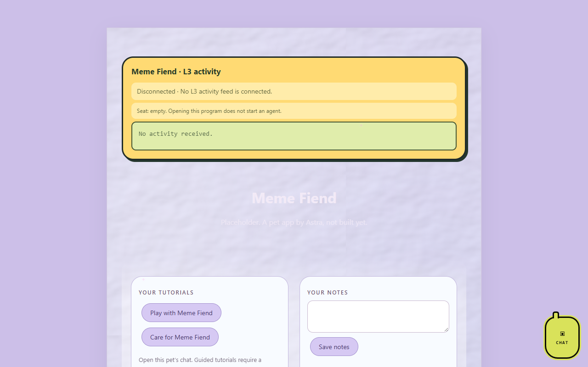

# Meme Fiend

*A pet app by Astra.*

Meme Fiend is a meme saver and maker. This repository is a placeholder: the app itself is not built yet.

## Pictures

Meme Fiend's program page (`index.html`) as it looks on OpenAI Codex's `codex/l3-activity-20261016` branch, which adds the L3 activity bubble, tutorials and notes and is not merged into `main` yet. The app itself is a placeholder.

Screenshots taken 2026-10-17 with GitHub Goldfish's [project-image-generator](https://github.com/findastra/github-goldfish#project-image-generator); added with Claude Opus 5.5 (`claude-opus-5-5`), 2026-10-17.

## Status

Placeholder. Nothing is implemented.

## Planned

- Save memes you find, with tags and notes, stored locally on your PC.
- Make new memes from images with top and bottom text.

## How to run it

Open `index.html` in any modern browser. It shows a placeholder page and nothing else.

## Limits

- Placeholder only: no behaviour, data or storage yet.
- No pet art yet. `sprite.json` is an empty stub.
- In the hub's registry as a pipeline pet ([pets.json](https://github.com/findastra/astras-pet-os/blob/main/pets.json)): it has its own repo and is not registered yet.

Desktop appearance draft updated 2026-10-11: see [desktop details](desktop-pet-20261011.json). This changes the desktop pet, not application features.
